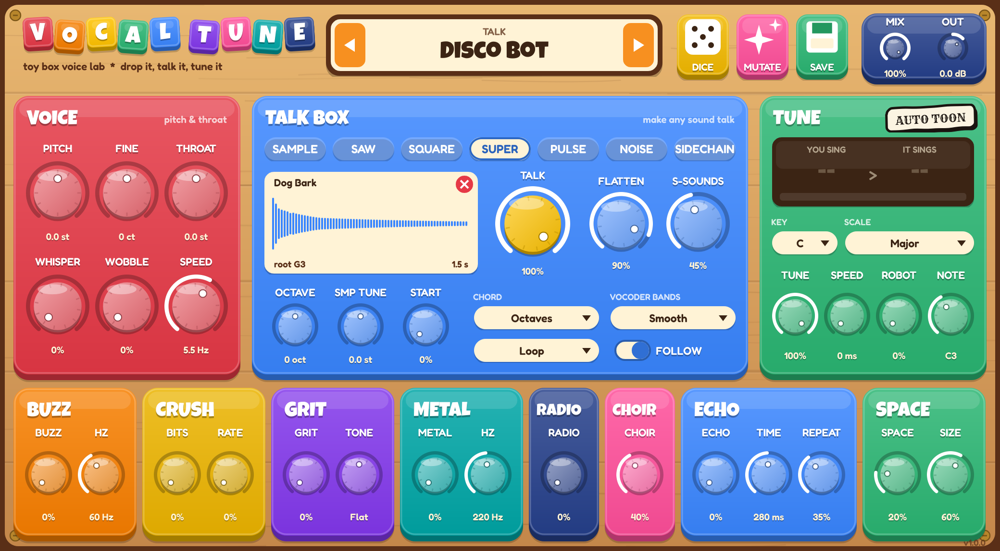
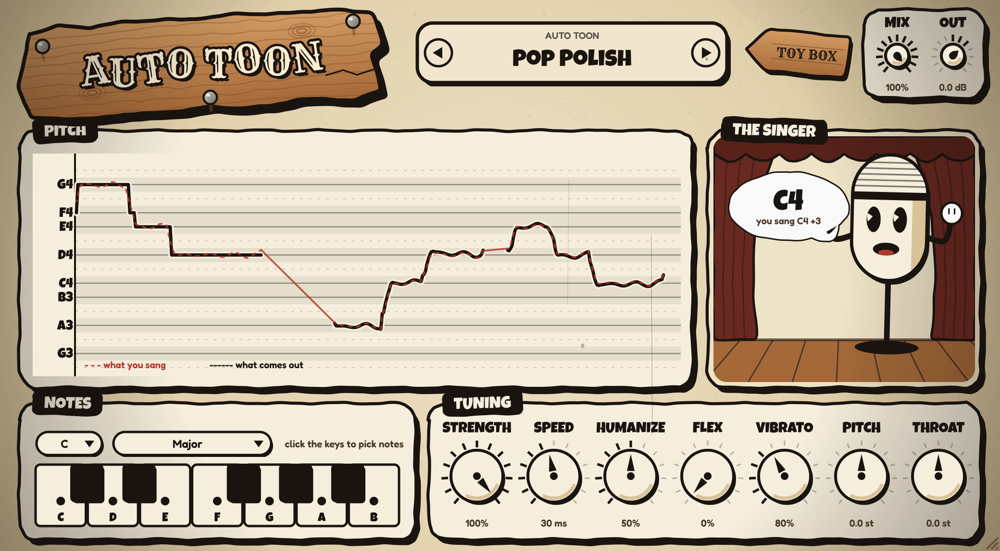

# VocalTune

Toy box voice lab for Ableton Live (VST3 + Audio Unit, Mac).

- **Voice changer** with separate pitch and throat (formant) control: monster, giant, baby, chipmunk, robot, demon, ghost, alien...
- **Talk box**: drop any sample (or pick a built-in synth, noise, or the sidechain) and your voice makes it talk, sing your notes, in chords.
- **Tune & Robot**: snap to a key and scale, or flatten to one note.
- **Effects**: buzz, crush, grit, tone, metal, radio, choir, echo, space.
- **Auto Toon**: flip the plugin over for a full auto-tune in a 1930s inkwell cartoon style: retune speed, humanize, flex-tune, vibrato control, pick-your-notes piano, a live pitch graph and a singing microphone.
- **77 presets**, DICE (random), MUTATE (nudge), and your own saved presets.




## Getting the plugin

Every push to `main` is built on GitHub's Macs (universal: Apple Silicon + Intel), tested, installed and checked with Apple's `auval` and `pluginval`.

1. Open the repository's **Actions** tab, then the latest green **Build VocalTune** run.
2. Download **VocalTune-mac** at the bottom, unzip it, and open **VocalTune.pkg**.

The same files are also on the `builds` branch.

If macOS says the installer can't be opened, right-click it and pick **Open**
(it isn't signed with an Apple Developer ID yet; signing switches on by itself
when the `MACOS_CERTS_P12`, `MACOS_CERTS_PASSWORD`, `APPLE_ID`, `APPLE_TEAM_ID`
and `APPLE_APP_PASSWORD` secrets are added).

## How it works

`Source/dsp/SpectralEngine.cpp` runs a 2048-point STFT. Each frame's spectrum is
split into an envelope (cepstral "true envelope": the throat) and the excitation
(the pitch). The voice changer shifts excitation peaks with a peak-locked phase
vocoder and re-applies a warped envelope, so pitch and formants move separately.
The talk box whitens the carrier's spectrum and multiplies in the voice envelope.
YIN pitch tracking drives tune, robot, and the carrier's notes.

## Building locally

```
git clone --depth 1 --branch 9.0.4 https://github.com/juce-framework/JUCE.git JUCE
cmake -B build -DCMAKE_BUILD_TYPE=Release -DVT_BUILD_TESTS=ON
cmake --build build --config Release
./build/VocalTuneTests_artefacts/Release/VocalTuneTests
```

Fonts: Fredoka (SIL OFL) and Luckiest Guy (Apache 2.0), licenses in `Resources/fonts`.
Built with JUCE.
